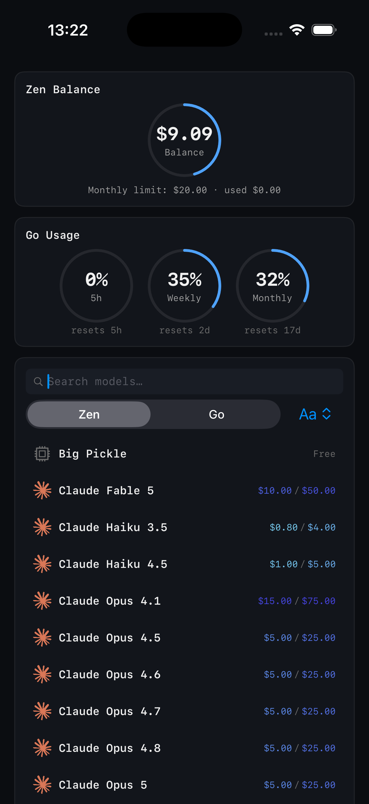

# dandelion-ios

A native iOS app for **OpenCode Zen** (pay-as-you-go) and **OpenCode Go** (subscription) - live balance/usage plus the full model catalog. iOS counterpart to the [macOS menu-bar app](https://github.com/Yyukan/dandelion).


## What it shows

- Zen balance, auto-reload threshold, monthly limit
- Go 5h/weekly/monthly usage windows and reset countdowns
- Zen/Go model catalog: pricing and context/output limits

<p align="center">
  
</p>

## Widgets

- **Lock Screen** — one complication per metric: Balance, 5h, Weekly, Monthly
- **Home Screen** — a single dashboard with all four at a glance

## Requirements

- iOS 17+, Xcode 16+
- [XcodeGen](https://github.com/yonaskolb/XcodeGen): `brew install xcodegen`
- An Apple ID in Xcode to sign the app for your device (free personal team is enough)

## Credentials

- **One API key, both cards** — create a key in the [OpenCode console](https://opencode.ai/console/) (Go or personal), then paste it into Settings. It is stored in the iOS Keychain only.
- The key reads your **Zen balance** (`/console/api/billing/status`) and your **Go usage** (`/inference/go/v1/usage`). There is no sign-in and no browser session; the app never calls a model, so it never spends credits.
- The model catalog needs no credential at all — it comes from OpenCode's public model lists and docs pages.
- Remove or replace the key in Settings; removing it must be explicit (a key typed and never submitted is saved on focus loss, so it isn't lost).

## Running locally

```bash
xcodegen generate
open DandelionIOS.xcodeproj
```

Select the **DandelionIOS** scheme, pick your iPhone (or a Simulator), press **Run** (⌘R). First run on a device: pick your team under Signing & Capabilities. The Lock Screen + Home Screen widgets become available in the widget gallery once the host app has been installed.

## License

See [LICENSE](LICENSE).
